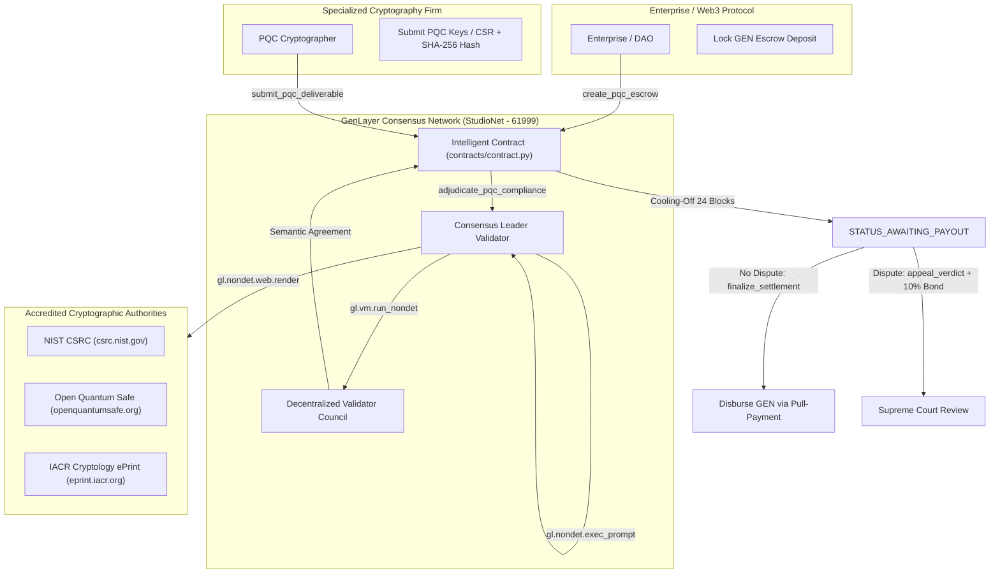
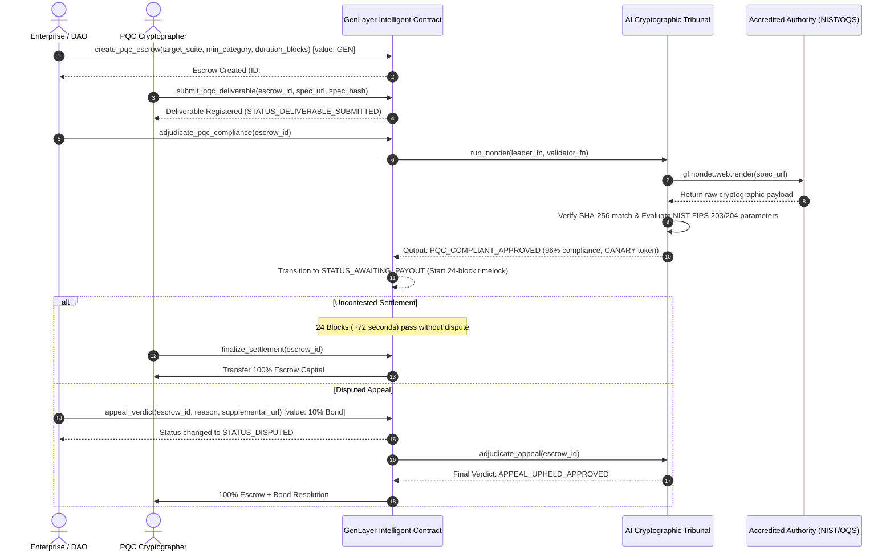
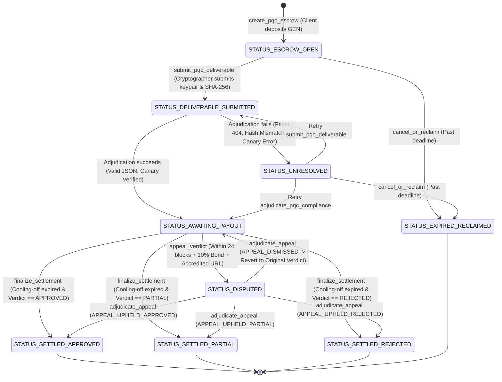

# 🏛️ AgentQuantumGuard — Architectural Specification & Consensus Design

This document details the architectural topology, cryptographic state machine, and GenLayer semantic consensus mechanics governing **AgentQuantumGuard**.

---

## 📌 1. High-Level System Architecture



---

## 🔄 2. End-to-End Execution Sequence



---

## ⚙️ 3. State Machine Transitions



---

## 🔒 4. Key Architectural Invariants

1. **Deterministic Consensus with Natural Language Agreement:**
   Validators in GenVM do not compare byte-for-byte LLM explanations; instead, the consensus predicate checks:
   $$\text{leader.verdict} == \text{validator.verdict} \quad \land \quad \text{canary} == \text{CANARY\_AGENT\_QUANTUM\_GUARD\_V1}$$
2. **Double-Spend & Reentrancy Prevention:**
   Prior to any external fund transfer, the contract zeroes out the escrow and bond amounts:
   ```python
   escrow_val = e.escrow_amount
   e.escrow_amount = bigint(0) # Checks-Effects-Interactions
   self._safe_transfer(recipient, escrow_val)
   ```
3. **Pull-Payment Recovery Buffer:**
   If a direct native transfer to a smart contract recipient encounters an execution error, the funds are safely buffered into `self.claimable_balances[recipient]`, claimable anytime via `claim_payout()`.
