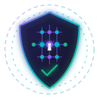

# 🛡️ AgentQuantumGuard: Autonomous Post-Quantum Cryptography Migration Escrow & Key Verification Tribunal

<p align="center">
  
</p>

[](https://studio.genlayer.com)
[](https://explorer-studio.genlayer.com)
[](https://agent-quantum-guard.vercel.app)
[](LICENSE)

> **Web3 CyberSecurity / Post-Quantum Cryptography (PQC) / NIST Standards Oracle:**
> Autonomous migration escrow, lattice parameter verification, and on-chain appellate court on GenLayer GenVM.

---

## 📌 Executive Pitch & Problem Statement

### *"Why AgentQuantumGuard is Impossible without GenLayer"*
The rapid advent of quantum computing poses an existential threat to blockchain infrastructure and classical public-key cryptography. Under **Shor's Algorithm**, traditional EVM signature schemes (`secp256k1`, `ECDSA`, `RSA`, `BLS`) will become trivially forgeable.

To avoid catastrophic protocol collapse, financial institutions, DAOs, and Web3 protocols are spending millions hiring cryptographic engineering firms to migrate their systems to **NIST-standardized Post-Quantum Cryptography (PQC)** algorithms:
- **ML-KEM (FIPS 203)**: Module-Lattice Key Encapsulation Mechanism (formerly CRYSTALS-Kyber)
- **ML-DSA (FIPS 204)**: Module-Lattice Digital Signatures (formerly CRYSTALS-Dilithium)
- **SLH-DSA (FIPS 205)**: Stateless Hash-Based Digital Signatures (formerly SPHINCS+)

### The Systemic Deadlock in Traditional Web3:
1. **The Asymmetric Verification Gap:** Enterprises and DAO governance councils lack specialized mathematical capabilities to inspect submitted public keys, Certificate Signing Requests (CSRs), and lattice parameters to verify whether they genuinely satisfy NIST security levels or contain catastrophic mathematical backdoors (e.g., non-standard ring modulus $q$, degenerate polynomial degrees, or compromised noise distributions).
2. **The Escrow Catch-22:** If the enterprise pays upfront, contractors may deliver non-standard or weak keys. If payment is withheld until integration, cryptographers refuse to release mission-critical migration deliverables.
3. **The Traditional Oracle Problem:** Standard EVM contracts cannot ingest 100-page mathematical specifications, fetch external cryptographic benchmarks, or evaluate lattice polynomial dimensions without trusted centralized multisigs.

### The GenLayer Solution:
**AgentQuantumGuard** solves this deadlock through an autonomous on-chain regulatory oracle and escrow protocol. Validators on GenLayer GenVM independently fetch cryptographic deliverables via `gl.nondet.web.render`, verify content SHA-256 commitments, evaluate lattice parameters against **NIST FIPS 203/204/205** using `gl.nondet.exec_prompt`, and reach consensus via `gl.vm.run_nondet` semantic agreement.

---

## 🏛️ Smart Contract Specification & Deployment

- **Intelligent Contract:** `contracts/contract.py`
- **Consensus Runtime:** GenLayer GenVM Python (`py-genlayer`)
- **Target Network:** GenLayer StudioNet (Chain ID: `61999` / Hex: `0xF22F`)
- **RPC Endpoint:** `https://studio.genlayer.com/api`
- **Authoritative Deployed Address:** [`0xAF808C4857Ec4593e3CbFfed67D42AbB40FF9107`](https://explorer-studio.genlayer.com/address/0xAF808C4857Ec4593e3CbFfed67D42AbB40FF9107)
- **Block Explorer:** [View Contract on GenLayer Studio Explorer](https://explorer-studio.genlayer.com/address/0xAF808C4857Ec4593e3CbFfed67D42AbB40FF9107)

### Lifecycle State Machine

| Status Code | Status Name | Description |
|:---:|:---|:---|
| `0` | `STATUS_ESCROW_OPEN` | Enterprise locks GEN escrow; awaiting cryptographer deliverable submission |
| `1` | `STATUS_DELIVERABLE_SUBMITTED` | Cryptographer submits PQC specification URL and genuine SHA-256 hash commitment |
| `2` | `STATUS_AWAITING_PAYOUT` | AI Cryptographic Tribunal renders verdict; 24-block dispute cooling window active |
| `3` | `STATUS_SETTLED_APPROVED` | Full NIST compliance verified ($\ge 85\%$); 100% escrow disbursed to cryptographer |
| `4` | `STATUS_SETTLED_PARTIAL` | Lower security level verified (e.g. Cat 1 vs Cat 5); 40% payout, 60% refunded |
| `5` | `STATUS_SETTLED_REJECTED` | Insecure or non-standard lattice parameters detected; 100% refunded to enterprise |
| `6` | `STATUS_DISPUTED` | 10% dispute bond staked; Supreme Appellate Tribunal re-evaluating bound evidence |
| `7` | `STATUS_EXPIRED_RECLAIMED` | Migration window expired unfulfilled; escrow reclaimed by enterprise |
| `8` | `STATUS_UNRESOLVED` | Fail-safe protected state (network 404, hash mismatch, or canary error; non-settling) |

---

## 🔒 Security & Semantic Consensus Architecture

1. **Semantic Agreement vs Schema Consensus:** Independent validators in GenVM run the leader evaluation and compare verdicts (`leader["verdict"] == mine["verdict"]`) and security canary tokens, tolerating natural variance in LLM rationale while strictly guaranteeing deterministic mathematical consensus.
2. **Anti-Prompt-Injection Canary Token:** Every prompt dynamically verifies the `CANARY_AGENT_QUANTUM_GUARD_V1` security token. Payloads omitting or corrupting this token immediately abort to `UNRESOLVED_CANARY_FAILED`.
3. **SHA-256 Content Integrity Commitment:** Cryptographers commit a 64-character hex SHA-256 hash upon submission. Consensus nodes compute `hashlib.sha256(raw_doc)` and halt execution if server-side tampering is detected.
4. **24-Block Dispute Cooling-Off Window:** Following initial adjudication, capital is timelocked for 24 blocks (~72s). Stakeholders can file an appeal by staking a **10% dispute bond** with bound evidence from accredited cryptographic authorities (`ACCREDITED_PQC_SOURCES`).
5. **Checks-Effects-Interactions & Pull-Payment:** Escrow balances are zeroed prior to native transfers (`e.escrow_amount = bigint(0)`). If a transfer to a recipient contract reverts, funds are buffered into `claimable_balances`, safely recoverable via `claim_payout()`.

---

## 🧪 Comprehensive Pytest Test Suite

AgentQuantumGuard includes 10 automated test suites in `tests/test_agentquantumguard.py` verifying all lifecycle pathways, boundary conditions, and cryptographic edge cases:

```bash
python -m pytest tests
```

- `test_pqc_compliant_approved_full_payout_lifecycle`: Verifies 100% escrow release to cryptographer for verified ML-KEM-768 deliverable.
- `test_pqc_partial_compliance_lifecycle`: Verifies 40% payout / 60% refund when deliverable satisfies Category 1 instead of contracted Category 5.
- `test_pqc_insecure_rejected_lifecycle`: Verifies 100% refund when weak lattice modulus ($q=2048$) is flagged.
- `test_pqc_fetch_failure_produces_unresolved_state`: Verifies that 404/network errors trigger `STATUS_UNRESOLVED` and block premature settlement.
- `test_pqc_commitment_hash_mismatch`: Verifies that tampered server documents trigger `UNRESOLVED_COMMITMENT_FAILED`.
- `test_pqc_security_canary_mismatch`: Verifies that jailbreak attempts omitting the canary token fail closed.
- `test_appeal_requires_accredited_source_and_bond`: Enforces the 10% dispute bond requirement and rejects unaccredited URLs.
- `test_appellate_tribunal_adjudication_uphold`: Proves that appellate court evaluates supplemental evidence and overturns verdicts.
- `test_cooling_off_window_prevents_premature_settlement`: Verifies that settlement attempts before 24 blocks (~72s) elapse strictly revert.
- `test_contract_stats_and_views`: Verifies protocol statistics, escrow counters, and view methods.

---

## 💻 Tech Stack & Project Structure

- **Intelligent Contract:** GenLayer GenVM Python (`py-genlayer`)
- **Frontend Framework:** React 18, Vite, TypeScript
- **Styling:** TailwindCSS ("Post-Quantum Cryptography Terminal" Design System)
- **Web3 Integration:** `genlayer-js` + MetaMask
- **Icons:** Lucide React

```
AgentQuantumGuard/
├── contracts/
│   └── contract.py                 # Core Intelligent Contract on GenVM
├── tests/
│   └── test_agentquantumguard.py   # Comprehensive Pytest Test Suite (10 tests)
├── scripts/
│   ├── deploy_studionet.py         # Automated StudioNet Deployment Script
│   └── seed_demo_escrow.py         # On-chain Escrow Seeding Script
├── docs/
│   ├── ARCHITECTURE.md             # System Topologies & Mermaid Diagrams
│   ├── SECURITY.md                 # Threat Model & Cryptographic Invariants
│   ├── CHANGELOG.md                # Semver Release Log for Milestones 1-4
│   └── MILESTONES.md               # Milestone Roadmap & Evidence Summary
├── frontend/                       # Full-Stack React + Vite Web3 dApp
│   ├── src/
│   │   ├── components/             # Navbar, EscrowCard, Modals, PullPayout
│   │   ├── config/genlayer.ts      # StudioNet RPC & Contract Configuration
│   │   └── utils/formatters.ts     # GEN, Timestamp & Address Formatters
│   ├── package.json
│   ├── vite.config.ts
│   └── tailwind.config.js
├── deployment.json                 # Deployed contract metadata
└── README.md
```

---

## 🚀 Running Locally

### 1. Run Contract Tests
```bash
python -m pytest tests
```

### 2. Run Frontend
```bash
cd frontend
npm install
npm run dev
```
Open `http://localhost:5173` in your browser. Configure MetaMask with GenLayer StudioNet:
- **RPC URL:** `https://studio.genlayer.com/api`
- **Chain ID:** `61999` (Hex: `0xF22F`)
- **Symbol:** `GEN`

---

## 📄 License
MIT License. Built for the GenLayer Builder Program.
